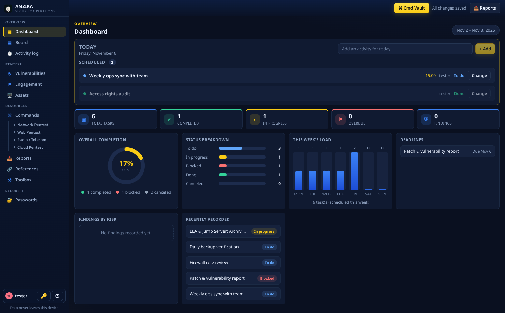
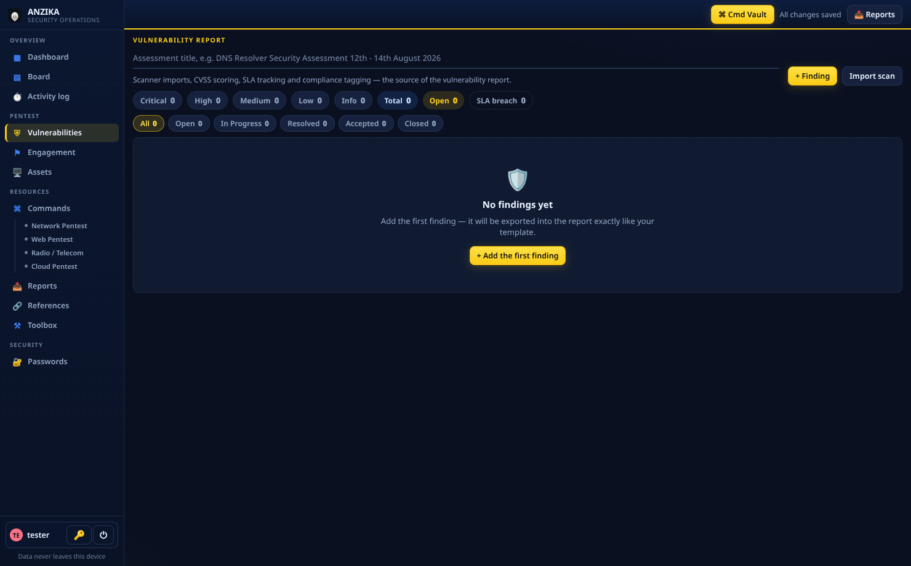
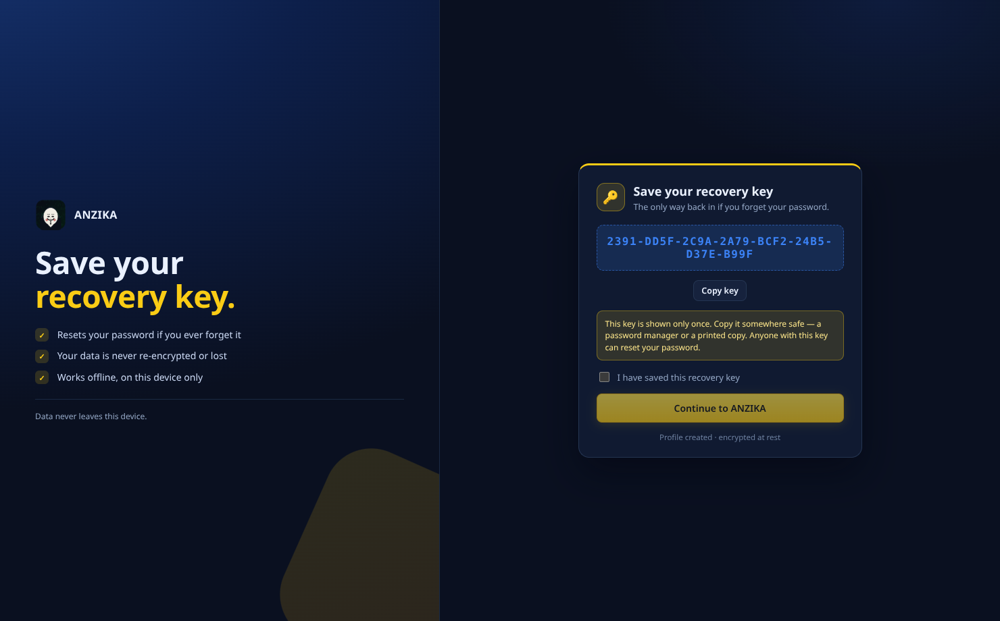
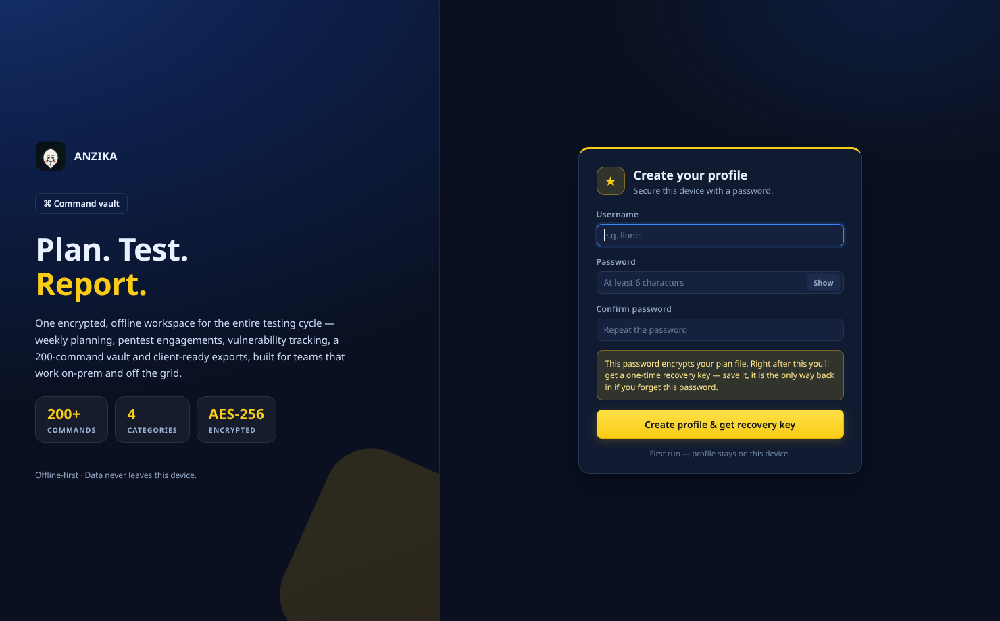
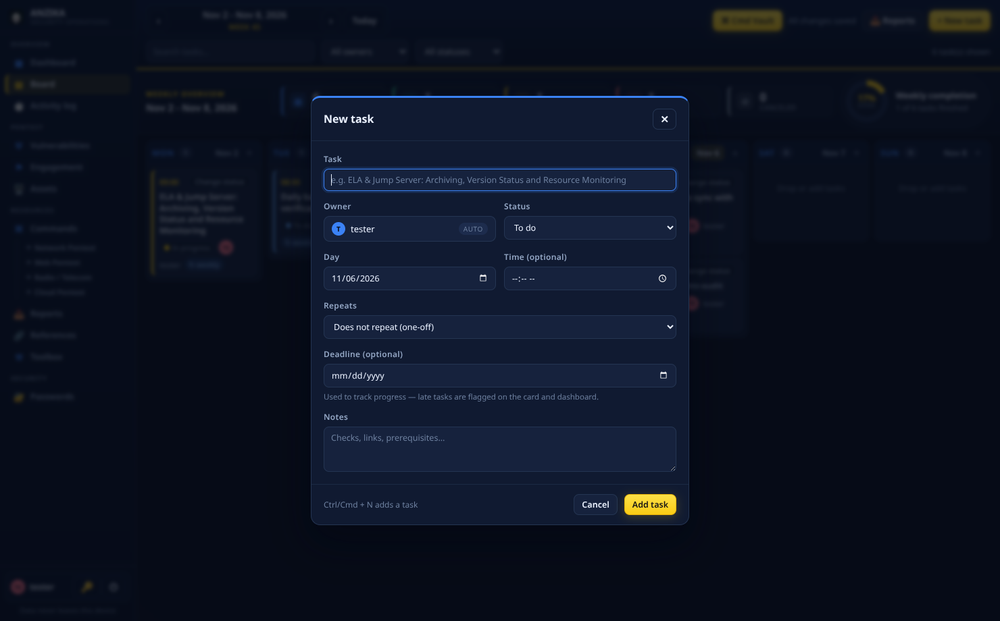

<div align="center">

# ANZIKA

**Plan. Test. Report.** — one encrypted, offline workspace for the entire security-operations cycle.

Weekly planning · pentest engagements · vulnerability tracking · assets · 200+ command vault · client-ready exports

</div>

<div align="center">



</div>

> **ANZIKA** is a single-user desktop app built for InfoSec teams (and growers, analysts, freelancers) who plan their week, run engagements, track vulnerabilities and hand reports to clients — without any of that leaving the machine.
>
> - **Offline-first:** data never leaves this device; no accounts, no telemetry.
> - **Encrypted at rest:** AES-256-GCM plan file, scrypt-verifier login, password vault with a second factor.
> - **Report-ready:** weekly/daily XLSX + PPTX for the department template, scope PDFs and full client pentest reports.

---

## Contents

1. [Features](#features)
2. [Install](#install)
3. [Uninstall](#uninstall)
4. [Getting started](#getting-started)
5. [Keyboard shortcuts](#keyboard-shortcuts)
6. [Build from source](#build-from-source)
7. [Testing](#testing)
8. [Architecture](#architecture)
9. [Security](#security)
10. [Data & backups](#data--backups)
11. [Troubleshooting](#troubleshooting)
12. [License](#license)

---

## Features

| Area | What you get |
| --- | --- |
| **Weekly board** | Mon–Sun columns, drag-and-drop task cards with time + status accents, native new-task dialog (`Ctrl/Cmd+N`) |
| **Status wizard** | Guided *plan → in progress → blocked → done → cancelled* flow with an activity log entry per change |
| **Recurring duties** | Weekly & monthly tasks auto-clone forward, never duplicate, and survive deletion of individual occurrences |
| **Today panel** | Quick-add + instant status change for the current day |
| **Dashboard** | Completion ring, status breakdown, week load chart, deadlines, findings-by-risk |
| **Activity log** | Every create/status/reopen recorded, filterable, exportable |
|  | Vulnerability findings with **CVSS 3.1 / 4.0 vector calculator**, control framework tagging, SLA age badges, status filters and screenshot evidence (paste or drag & drop) |
| **Scanner imports** | Nessus and generic scan CSV reports import straight into findings |
| **Asset registry** | Import inventories from XLSX / CSV / TSV, edit inline, export a formatted workbook |
| **Engagements** | Scope-in/out, rules of engagement, phased checklists, one-click task generation from a template |
| **Pentest reports** | Executive summary → methodology → detailed findings → appendices, rendered to **PDF** or standalone **HTML** |
| **Command vault** | 200+ curated pentest commands (recon, network, web, cloud, AD…) with instant search, copy buttons and a palette (`Ctrl/Cmd+K`), plus your own custom commands |
| **Password vault** | AES-GCM encrypted entries, open with a secret key, a separate *action password* gates every reveal/copy/edit/delete |
|  | One-time recovery key at signup — reset a forgotten password without any server round-trip |
| **Cyber toolbox** | CIDR calculator, base64 encoder/decoder, MD5/SHA-1/SHA-256/SHA-512 hash tool, port lookup |
| **Reference library** | Curated cheat-sheet/tool links, chip filters, add your own |

## Install

### Linux

**Option A — Debian package (recommended)**

```bash
sudo apt install ./ANZIKA-1.0.0.deb      # or: sudo dpkg -i ANZIKA-1.0.0.deb
```

Downloads: `ANZIKA-<version>.deb` from [Releases](https://github.com/kt-lionel/planner/releases). Installs to
`/opt/ANZIKA`, adds an “ANZIKA” menu entry and `anzika` CLI-style launcher.

**Option B — AppImage (portable)**

```bash
chmod +x ANZIKA-1.0.0.AppImage
./ANZIKA-1.0.0.AppImage
```

No install step; just run it from anywhere (e.g. `~/Applications`).

### Windows

Downloads: `ANZIKA-Setup-<version>.exe` from [Releases](https://github.com/kt-lionel/planner/releases).

1. Run the setup.
2. Click **Install** — default location is the per-user `...\AppData\Local\Programs\ANZIKA` (changeable at step "Choose location").
3. Desktop and Start-menu shortcuts are created. A full friendly uninstaller ships with it.

> **Note on SmartScreen:** the installer is not yet code-signed, so Windows may warn on first run. Click *More info → Run anyway*, or hold off until you build/sign it yourself (see [Build from source](#build-from-source)).

### Builds via CI (recommended for authors)

Tagging a release (`git tag v1.0.1 && git push --tags`) triggers the
[release workflow](.github/workflows/release.yml) on GitHub Actions, which
builds **deb + AppImage** on Ubuntu and **NSIS setup.exe** on Windows and
attaches the artifacts to the release — no local Wine required for the Windows
build.

## Uninstall

### Linux

```bash
./scripts/uninstall.sh               # remove the app, keep user data
./scripts/uninstall.sh --purge-data  # also delete encrypted plan / vault / auth
```

Or classic package removal:

```bash
sudo apt remove weekly-planner       # or: sudo dpkg -r weekly-planner
# AppImage: simply delete the .AppImage file
```

### Windows

- **Start menu → ANZIKA → Uninstall** (ships with the NSIS installer), or
- **Settings → Apps → Installed apps → ANZIKA → Uninstall**.

This removes the app and its shortcuts but **keeps your encrypted data**
(`%APPDATA%\weekly-planner`) so reinstalling recovers everything. Delete that
folder manually for a full purge.

## Getting started



1. **First run:** create a profile — *username + master password*. ANZIKA immediately shows the one-time recovery key. **Save it offline** (printed/paper/password manager). It is the only way back in if the password is forgotten.
2. **Weekly board:** add tasks with the top-right `+ New task` button, drag them between days, tick through the status wizard.
3. **Modal tasks** can carry notes, deadlines, assignee tags and recurrence.
4. **Reports hub** (top right) exports the week/day as the department XLSX/PPTX template, scope documents for engagements, and the full pentest report.
5. **Passwords** tab is the vault: create it with a secret key + a *different* action password, then copy codes with confidence.



## Keyboard shortcuts

| Key | Action |
| --- | --- |
| `Ctrl/Cmd + N` | New task |
| `Ctrl/Cmd + K` | Open the command palette (200+ commands, fuzzy search, one-key copy) |
| `Esc` | Close the active modal / palette / search |

## Build from source

```bash
git clone git@github.com:kt-lionel/planner.git weekly-planner
cd weekly-planner
npm ci
npm run dev          # dev server + live reload
npm run dist         # AppImage + deb in dist/
npm run dist:win     # NSIS setup.exe (needs Wine on Linux, or Windows-native)
```

Artifacts land in `dist/`:

| File | Platform |
| --- | --- |
| `ANZIKA-<version>.AppImage` | Linux (portable) |
| `ANZIKA-<version>.deb` | Debian / Ubuntu / Mint |
| `ANZIKA-Setup-<version>.exe` | Windows 10/11 x64 (NSIS) |

> On Linux, `dist:win` requires Wine (`sudo apt install wine`) because the NSIS
> stamping step patches the exe metadata. The GitHub Actions workflow avoids
> this by building on an actual Windows runner.

## Testing

```bash
npm test
```

Runs the full battery: TypeScript checks, a batch-verify smoke of all core
modules (auth + encrypted storage + every report builder + the vault state
machine), a scripted **UI probe** of every screen (drag targets, modals,
filters, pagination, clipboard gating, pasted evidence), and an end-to-end
**auth + recovery + vault-reset** browser flow. Screenshots land in `/tmp`.

## Architecture

```
src/
├── main/                 Electron main process
│   ├── index.ts          app lifecycle, window, IPC surface, smoke harnesses
│   ├── auth.ts           scrypt verifier, wrapped plan key, recovery keys
│   ├── store.ts          encrypted plan persistence, recurrences, plan lock
│   ├── vault.ts          password vault + action-password state machine
│   ├── validate.ts       IPC input validation (coercion, caps, URL policy)
│   └── report/pptx/…     exceljs / pptxgenjs / PDF report builders
├── preload/              contextBridge — the only renderer surface
├── renderer/src/         React UI (components/, lib/, styles.css)
└── shared/               typed contracts + parsers (CSV, scan, CVSS)
```

- **Persistence:** every write is temp-file + atomic rename, with `.bak`
  rotation and `.corrupt-*` quarantine on damage.
- **State machine:** all plan mutations go through a promise lock (`withPlanLock`)
  so the renderer is never the source of truth.

## Security

The full model lives in [SECURITY.md](SECURITY.md). Highlights:

- scrypt password verifier + timing-safe compares; 1.5 s backoff after 3 failures
- AES-256-GCM plan envelope; independent plan key wrapped per password change
- Password vault entries additionally gated by a second, separate action password
- One-time 16-byte recovery key; rotation kills the previous key
- Electron: `sandbox: true`, context isolation, strict CSP, no remote content,
  validated IPC, denied web permissions, single-instance lock

Please report vulnerabilities privately via a [GitHub security advisory](https://github.com/kt-lionel/planner/security/advisories/new) — no public issues for undisclosed findings.

## Data & backups

| Item | Where |
| --- | --- |
| Encrypted workspace | `~/.config/weekly-planner/plan.json` (Linux) · `%APPDATA%\weekly-planner\plan.json` (Windows) |
| Profile & recovery material | `auth.json` next to it |
| Last-good backup | `plan.json.bak` next to it, rewritten on every save |

Export the workspace **as an ANZIKA JSON** from *Reports → Import & Export* for
a portable encrypted offsite copy (.json is AES-GCM-wrapped with your session
key); plain XLSX/CSV exports carry just the visible data.

## Troubleshooting

| Symptom | Fix |
| --- | --- |
| “Locked: sign in first.” | That is expected after lock/logout — enter the password to resume. |
| Forgot password | Use **Forgot password** with the recovery key. No key? The data cannot be recovered — `rm plan.json` starts fresh. |
| AppImage won't launch | Check the Architecture is x86_64 and `fusermount` is present, or run `./ANZIKA.AppImage --no-sandbox` inside restricted VM sandboxes. |
| Wayland window blank | Launch with `--ozone-platform=x11` or set `ELECTRON_OZONE_PLATFORM_HINT=x11`. |
| Wrong icon after install | Remove `~/.cache/applications` or relaunch the app once — desktop refresh is asynchronous on some distros. |
| Reset a corrupted vault | `Passwords → Reset vault with login password` keeps the entries; a forgotten *action password* resets with the secret key instead. |

## License

[MIT](LICENSE) © 2026 mutabazi
